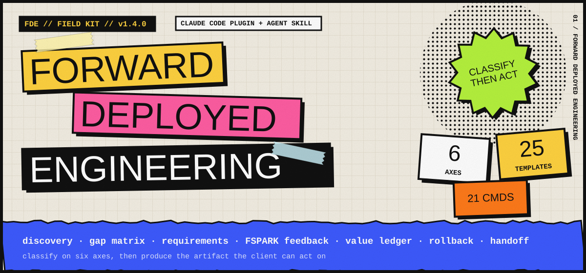
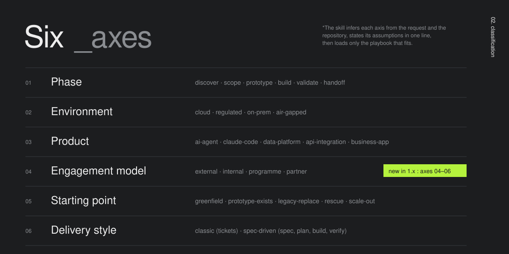
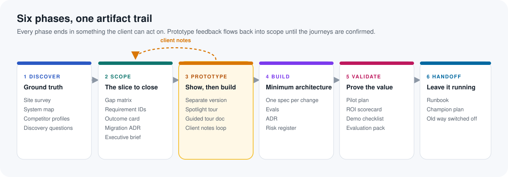
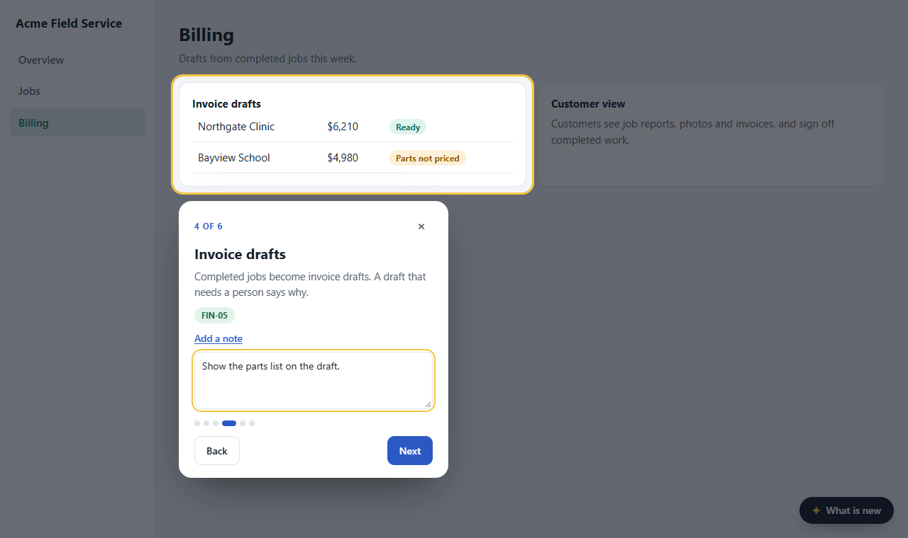
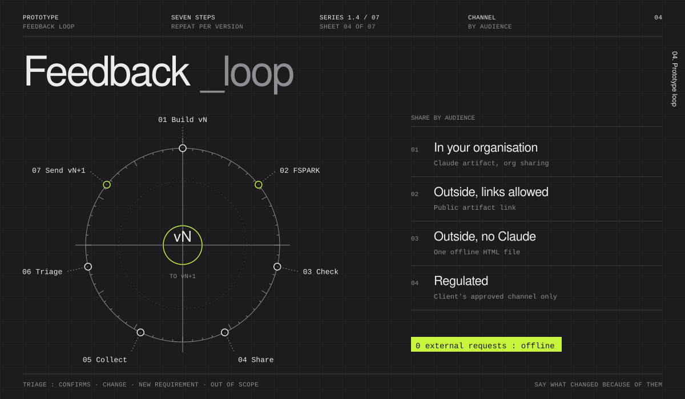

<!--
  Forward Deployed Engineering (FDE) skill and Claude Code plugin.
  Keywords: forward deployed engineer, forward deployed engineering, FDE playbook, FDE skill, Claude Code plugin,
  Claude skill, agent skill, customer deployment, client discovery, gap analysis, prototype, guided product tour,
  spotlight tour, pilot, ROI, handoff runbook, legacy system replacement, strangler migration, spec-driven delivery.
-->

<p align="center">
  
</p>

<p align="center">
  <a href="LICENSE"></a>
  <a href=".claude-plugin/marketplace.json"></a>
  
  
  
  
</p>

# Forward Deployed Engineering (FDE) skill and Claude Code plugin

**FDE is a free, open-source Claude Code plugin and agent skill for Forward Deployed Engineers.** It classifies an engagement on six axes (phase, environment, product, engagement model, starting point, delivery style). Then it produces the artifact that situation needs: discovery questions, a gap matrix, requirement IDs, a prototype with a guided spotlight tour, a pilot ROI scorecard, a demo checklist or a handoff runbook. It works for client deployments, internal platform replacements and FDE training programmes.

> **Install in Claude Code**
> ```
> /plugin marketplace add Jayzilva/FDE-forward-deployed-engineering-skill
> /plugin install fde@forward-deployed-engineering
> ```

**Contents:** [What is FDE](#what-is-forward-deployed-engineering) · [How it works](#how-it-works-classify-then-act) · [The six phases](#the-six-phases) · [Spotlight tours](#guided-spotlight-tours-show-the-client-what-you-will-build) · [What is included](#what-is-included) · [Install](#install) · [Quick start](#quick-start) · [FAQ](#faq) · [Key facts](#key-facts)

---

## What is Forward Deployed Engineering?

**A Forward Deployed Engineer (FDE) embeds with one client, team or programme and owns a deployment end to end, from the first discovery call to the day the old way is switched off.** The FDE closes *the Delta*: the gap between what a product does out of the box and what this client needs to succeed. About half the job is integration code. The other half is judgment about people, scope, data and risk, and that half is where most engagements fail.

FDE is a process, not a checklist. The right next move depends on the project, the audience and where the work starts. This plugin turns that judgment into a repeatable playbook.

## How it works: classify, then act

<p align="center"></p>

| Axis | Values | Why it matters |
|---|---|---|
| `01` **Phase** | discover · scope · prototype · build · validate · handoff | Decides the playbook and the artifact |
| `02` **Environment** | cloud · regulated · on-prem · air-gapped | Moves security, network and accreditation work to week one |
| `03` **Product** | ai-agent · claude-code · data-platform · api-integration · business-app | Sets the metrics, evals and handoff contents |
| `04` **Engagement model** | external · internal · programme · partner | Decides who signs off and what "done" means |
| `05` **Starting point** | greenfield · prototype-exists · legacy-replace · rescue · scale-out | Changes the first two weeks the most |
| `06` **Delivery style** | classic (tickets) · spec-driven (spec → plan → build → verify) | Sets the tracking unit, measures and AI cost model |

The skill infers each axis from your request and your repository, states its assumptions in one line, and loads only the playbook that fits. Every answer ends with an **FDE check**: the situation, the biggest risk now, and one next move with an owner and a date.

## The six phases

<p align="center"></p>

## Guided spotlight tours: show the client what you will build

A clickable prototype finds wrong requirements in days. A **spotlight tour inside the prototype** makes it self-explanatory. Each stop opens the right screen, highlights one new feature, explains it in plain words and lets the viewer leave a note. At the end the viewer copies every note and sends it back.

<p align="center"></p>

```
python scripts/add_spotlight.py prototype.html steps.json --out tour.html
```

The output is **one self-contained HTML file**: no external requests, works offline, safe to email. Then share it through the channel that fits the audience:

<p align="center"></p>

| Audience | Channel | Feedback comes back as |
|---|---|---|
| Inside your organisation | Claude artifact shared with the organisation | Artifact comments and copied notes |
| Outside, public links allowed | Claude artifact with "anyone with the link" | Copied notes in a reply |
| Outside, no Claude access | The single HTML file by email, portal or file share | Copied notes in a reply |
| Regulated or confidential | The single HTML file through the client's approved channel only | Copied notes, stored with engagement records |

Try it: open [`examples/spotlight-demo/index.html`](examples/spotlight-demo/index.html) in a browser. It is a fictional field-service prototype with a six-stop tour.

## What is included

| Part | Count | Highlights |
|---|---|---|
| Router skill `forward-deployed-engineering` | 1 | Classifies on six axes. Loads only the matching playbook. Under 500 lines |
| References | 18 | One per phase, engagement model, starting point, environment, product, market research, delivery style, knowledge base, stakeholders, failure modes, plain-English writing |
| Templates | 20 | Site survey, system map, competitor profile, gap matrix, requirements with trace, outcome card, executive brief, prototype scope, ADR, risk register, pilot plan, ROI scorecard, demo checklist, evaluation pack, handoff runbook and more |
| Scripts (Python 3) | 7 | `fde_state.py` · `qualify.py` · `roi_calc.py` · `capture_screens.py` · `build_tour.py` · `add_spotlight.py` · `ste_lint.py` |
| Slash commands | 17 | `/fde:start` `/fde:discover` `/fde:research` `/fde:scope` `/fde:gaps` `/fde:requirements` `/fde:brief` `/fde:prototype` `/fde:spotlight` `/fde:tour` `/fde:pilot` `/fde:roi` `/fde:demo` `/fde:evaluation` `/fde:status` `/fde:premortem` `/fde:handoff` |
| Agents | 3 | `engagement-reviewer` (pre-mortem) · `market-researcher` (sourced competitor profiles) · `demo-reviewer` (evidence-only gate review) |
| Eval cases | 5 | Regulated KYC discovery · Claude Code pilot ROI · air-gapped handoff · internal legacy replacement · programme gate plan |

### Scripts at a glance

| Script | What it does | Needs |
|---|---|---|
| `fde_state.py` | Keeps engagement state in `.fde/engagement.yaml`: six axes, stakeholders, risks, decisions, dated gates. `calendar` flags gates on weekends | stdlib |
| `qualify.py` | Ranks use cases by volume, complexity, measurability and readiness. Labels structural vs marginal gain | stdlib |
| `roi_calc.py` | Conservative and measured ROI. Refuses to run without a baseline | stdlib |
| `capture_screens.py` | Screenshots every screen of a prototype and records control positions | Playwright |
| `build_tour.py` | Builds a guided tour document: annotated screenshots, controls, gaps per screen | stdlib |
| `add_spotlight.py` | Adds an in-product spotlight tour with per-stop notes to any HTML prototype | stdlib |
| `ste_lint.py` | Lints runbooks, CLAUDE.md files and acceptance criteria for plain, unambiguous English | stdlib |

## Install

**Claude Code (plugin, recommended)**
```
/plugin marketplace add Jayzilva/FDE-forward-deployed-engineering-skill
/plugin install fde@forward-deployed-engineering
```

**Claude.ai or Claude desktop (skill only):** download [`dist/forward-deployed-engineering.skill`](dist/forward-deployed-engineering.skill) and upload it under Settings → Capabilities → Skills.

**Any agent that reads skills:** copy `plugins/fde/skills/forward-deployed-engineering/` into the agent's skills folder.

Requirements: Python 3.9 or later. `capture_screens.py` also needs Playwright (`uvx --with playwright python ...` or `pip install playwright`).

## Quick start

```
/fde:start Acme Logistics — dispatch agent pilot regulated ai-agent external greenfield
/fde:research Kantata, Rocketlane, Productive
/fde:gaps
/fde:prototype ./mock/index.html
/fde:spotlight ./mock/v2/index.html external-file
/fde:demo "Demo 1" fde/outcome-card.md specs/012/verify-report.md
```

You can also describe the situation in plain words. The skill triggers on deployment, pilot, prototype, legacy migration, gap analysis and programme-gate requests even when you do not say "FDE".

## Principles

1. Find the system of record before writing code.
2. Run what exists before you write requirements.
3. Show, then build. A spotlight tour turns a prototype into a conversation.
4. Replace legacy systems domain by domain, and keep what they do well.
5. Track the change, not the ticket. Done means the old way is switched off.
6. Evidence over explanation. A gate item passes when an artifact exists and someone else signs it.
7. Never invent client facts. Write `TBD — ask <role>`.
8. The goal is to become unnecessary.

## FAQ

### What does a Forward Deployed Engineer do?
A Forward Deployed Engineer works inside a client's environment to make a product succeed there. They run discovery, scope the smallest valuable slice, build integrations and prototypes, prove value with a pilot, and hand the system to an owner who keeps it running.

### How is an FDE different from a solutions engineer or a consultant?
A solutions engineer usually stops at the sale and the demo. A consultant often advises without owning the code. An FDE writes production code, owns the outcome, and stays until the client runs the system without them.

### What does this plugin produce?
Client-ready artifacts: site surveys, system landscape maps, competitor profiles, gap matrices, requirement IDs with a trace table, outcome cards, executive briefs, prototype scopes, spotlight tours, ADRs, risk registers, pilot plans, ROI scorecards, demo checklists, evaluation packs and handoff runbooks.

### How do I show a client what we are going to build?
Build a clickable prototype on sample data. Run `/fde:spotlight` to add a guided tour with one stop per new feature. Share it as a Claude artifact inside your organisation, as a public link if your policy allows, or as one offline HTML file for outside clients. Turn each note that comes back into a requirement change.

### Does it work for internal projects and FDE training programmes?
Yes. The engagement model axis covers external clients, internal platform teams, programme cohorts with dated gates and evidence rules, and partner deliveries.

### Does it work without Claude Code?
Yes. Upload the `.skill` file to Claude.ai or Claude desktop, or copy the skill folder into any agent that reads skills. The scripts run with plain Python.

### Is it tied to one company or vendor?
No. It is MIT-licensed and vendor-neutral. All examples use fictional companies.

## Key facts

| | |
|---|---|
| Name | Forward Deployed Engineering (FDE) skill and Claude Code plugin |
| Plugin id | `fde@forward-deployed-engineering` |
| Version | 1.2.0 (see [CHANGELOG](CHANGELOG.md)) |
| Licence | MIT |
| Author | [Jayzilva](https://github.com/Jayzilva) |
| Repository | https://github.com/Jayzilva/FDE-forward-deployed-engineering-skill |
| Works with | Claude Code, Claude.ai, Claude desktop, any agent that reads skills |
| Machine-readable summary | [`llms.txt`](llms.txt) |

## Develop and contribute

```
python tools/package.py        # validate manifests and links, run script self-tests, build dist/*.skill
claude plugin eval plugins/fde/skills/forward-deployed-engineering --allow-tools Write,Edit,Bash
```

Contributions are welcome: new environment or product sections, engagement models, templates and eval cases. Keep `SKILL.md` under 500 lines and its description under 1,024 characters. Keep every example fictional.

## Credits

Builds on public FDE material (Awesome-FDE-Roadmap, GeeksforGeeks FDE roadmap, Anthropic's delivery methodology outline) and on field practice from real programme and client deployments. `ste_lint.py` is vendored from [danyuchn/asd-ste100-skill](https://github.com/danyuchn/asd-ste100-skill) (MIT, see `scripts/LICENSE-asd-ste100`).

MIT licence.
