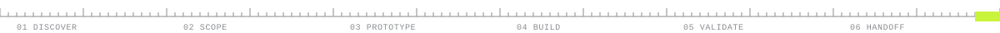
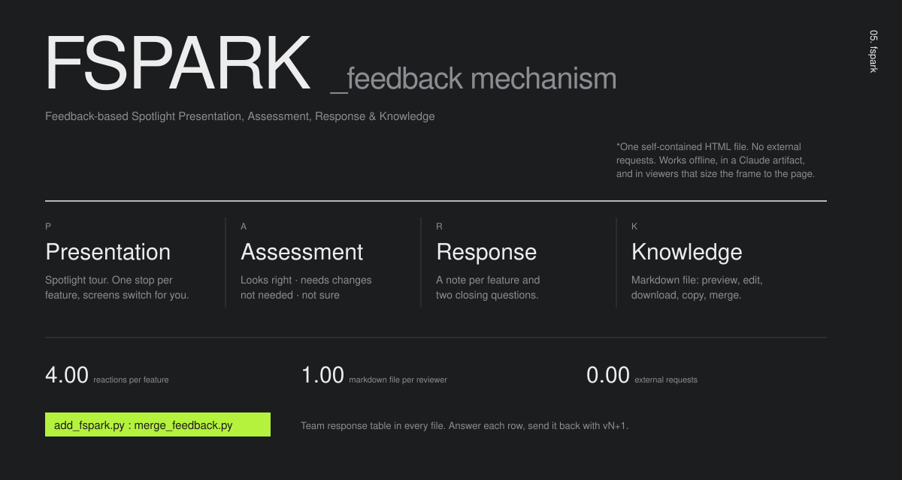
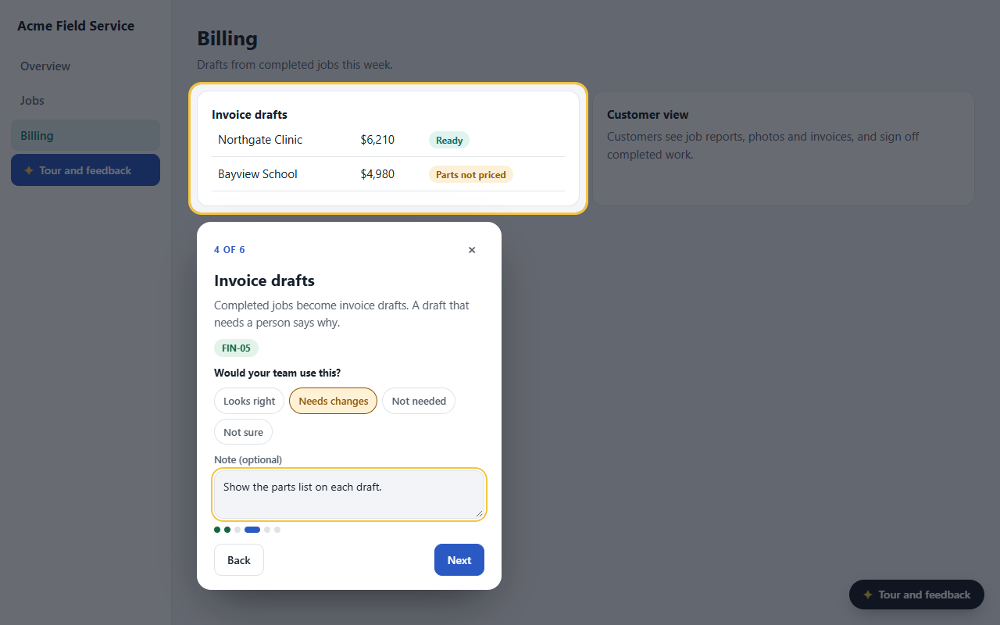
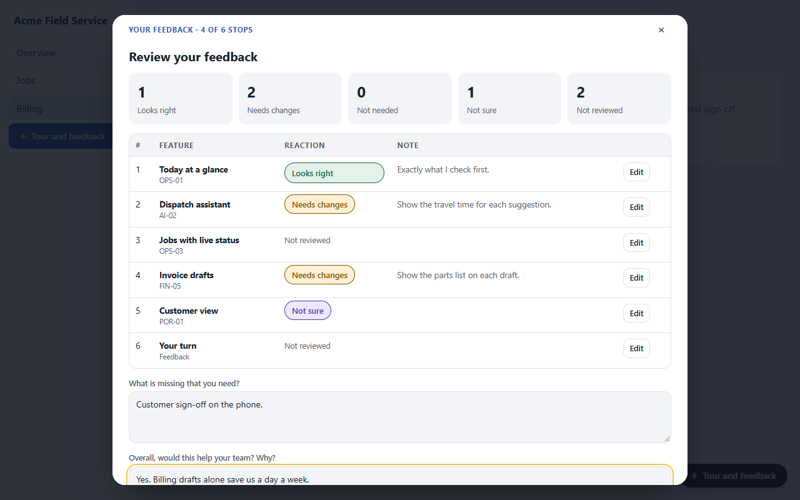
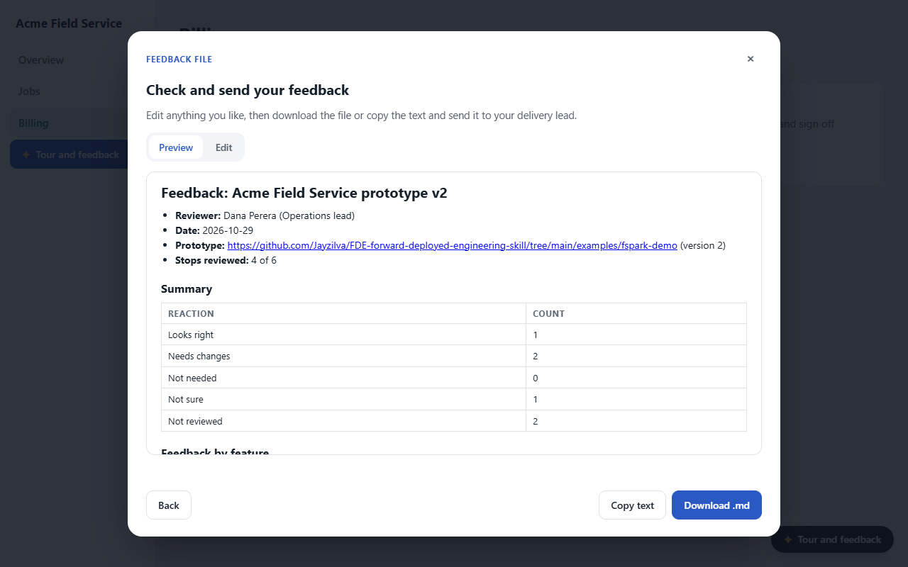
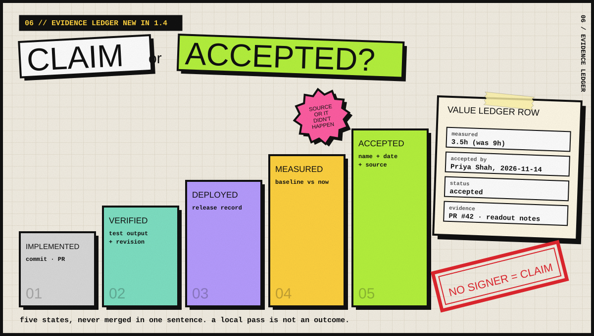
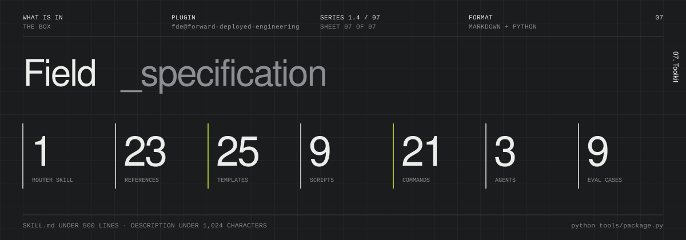

<!--
  Forward Deployed Engineering (FDE) skill and Claude Code plugin.
  Keywords: forward deployed engineer, forward deployed engineering, FDE playbook, FDE skill, Claude Code plugin, Claude skill,
  agent skill, customer deployment, client discovery, gap analysis, prototype, FSPARK, feedback-based spotlight tour,
  prototype feedback, value ledger, customer acceptance, evidence ledger, meeting debrief, assumption testing,
  blast radius, rollback drill, pilot, ROI, handoff runbook, legacy system replacement, strangler migration, spec-driven delivery.
-->

<p align="center">
  
</p>

<p align="center">
  <a href="LICENSE"></a>
  <a href="CHANGELOG.md"></a>
  
  
  
  
</p>

# Forward Deployed Engineering (FDE) skill and Claude Code plugin

**FDE is a free, open-source Claude Code plugin and agent skill for Forward Deployed Engineers.** It classifies an engagement on six axes (phase, environment, product, engagement model, starting point, delivery style). Then it produces the artifact that situation needs: discovery questions, a gap matrix, requirement IDs, a prototype with an FSPARK feedback tour, a value ledger that separates claims from client-accepted results, a pilot ROI scorecard, a demo checklist or a handoff runbook. It works for client deployments, internal platform replacements and FDE training programmes.

> [!TIP]
> **Install in Claude Code**
> ```
> /plugin marketplace add Jayzilva/FDE-forward-deployed-engineering-skill
> /plugin install fde@forward-deployed-engineering
> ```

**`CONTENTS`** &nbsp; [What is FDE](#what-is-forward-deployed-engineering) · [How it works](#how-it-works-classify-then-act) · [Six phases](#the-six-phases) · [FSPARK](#fspark-the-feedback-mechanism) · [Evidence ledger](#evidence-ledger-claim-or-accepted) · [What's in the box](#whats-in-the-box) · [Install](#install) · [Quick start](#quick-start) · [FAQ](#faq) · [Key facts](#key-facts)



## What is Forward Deployed Engineering?

**A Forward Deployed Engineer (FDE) embeds with one client, team or programme and owns a deployment end to end, from the first discovery call to the day the old way is switched off.** The FDE closes *the Delta*: the gap between what a product does out of the box and what this client needs to succeed. About half the job is integration code. The other half is judgment about people, scope, data and risk, and that half is where most engagements fail.

FDE is a process, not a checklist. The right next move depends on the project, the audience and where the work starts. This plugin turns that judgment into a repeatable playbook.

## How it works: classify, then act

<p align="center"></p>

| | Axis | Values | Why it matters |
|---|---|---|---|
| 🟨 `01` | **Phase** | discover · scope · prototype · build · validate · handoff | Decides the playbook and the artifact |
| 🟩 `02` | **Environment** | cloud · regulated · on-prem · air-gapped | Moves security, network and accreditation work to week one |
| 🟥 `03` | **Product** | ai-agent · claude-code · data-platform · api-integration · business-app | Sets the metrics, evals and handoff contents |
| 🟪 `04` | **Engagement model** | external · internal · programme · partner | Decides who signs off and what "done" means |
| 🟧 `05` | **Starting point** | greenfield · prototype-exists · legacy-replace · rescue · scale-out | Changes the first two weeks the most |
| 🟩 `06` | **Delivery style** | classic (tickets) · spec-driven (spec, plan, build, verify) | Sets the tracking unit, measures and AI cost model |

The skill infers each axis from your request and your repository, states its assumptions in one line, and loads only the playbook that fits. Every answer ends with an **FDE check**: the situation, the biggest risk now, and one next move with an owner and a date.

## The six phases

<p align="center"></p>


## FSPARK: the feedback mechanism

<p align="center"></p>

**FSPARK (Feedback-based Spotlight Presentation, Assessment, Response & Knowledge) turns a prototype into a structured feedback session.** It shows the people who will use the product exactly what was built, asks what they think of each feature, and returns their answers as a Markdown file the team acts on.

| | Step | What the viewer does | What you get |
|---|---|---|---|
| 🟨 `P` | **Presentation** | Follows a spotlight tour. Each stop opens the right screen and highlights one feature | A clear picture of what will be built |
| 🟥 `A` | **Assessment** | Rates each feature: looks right, needs changes, not needed, not sure | Reaction counts per feature and requirement ID |
| 🟩 `R` | **Response** | Adds a note per feature and answers two closing questions | Their words, tied to the feature |
| 🟢 `K` | **Knowledge** | Reviews everything, previews and edits a Markdown file, downloads or copies it | A feedback file with a team-response table |

<p align="center">
  
  
  
</p>

```
python scripts/add_fspark.py prototype.html config.json --out tour.html      # build
python scripts/merge_feedback.py feedback/*.md --out feedback-summary.md      # close the loop
```

The output is **one self-contained HTML file**: no external requests, works offline. Inside a Claude artifact, publish with capabilities `{"downloads": true}` so the download button saves the file. Elsewhere it downloads directly, and Copy always works.

<p align="center"></p>

| Audience | Channel | Feedback comes back as |
|---|---|---|
| Inside your organisation | Claude artifact shared with the organisation | Downloaded feedback file, or artifact comments |
| Outside, public links allowed | Claude artifact with "anyone with the link" | Downloaded or copied feedback file |
| Outside, no Claude access | The single HTML file by email, portal or file share | Downloaded feedback file |
| Regulated or confidential | The single HTML file through the client's approved channel only | Feedback file, stored with engagement records |

**Close the loop:** merge every reviewer's file, decide each row (confirms, change, new requirement, out of scope), update the requirement IDs, fill the team-response column and send it back with the next version. Try it: open [`examples/fspark-demo/index.html`](examples/fspark-demo/index.html), a fictional field-service prototype with a six-stop tour.


## Evidence ledger: claim or accepted?

<p align="center"></p>

**New in 1.4. A deployment is judged on what the client accepts, not on what the team reports.** The evidence ledger keeps five delivery states apart and refuses to promote a claim without proof.

| | State | Evidence that proves it |
|---|---|---|
| ⬜ `01` | **Implemented** | A commit, PR or change ID |
| 🟩 `02` | **Verified** | Test output or eval score on a named revision and environment |
| 🟪 `03` | **Deployed** | A release record in the client's environment |
| 🟨 `04` | **Measured** | Baseline and current value, method, sample, date |
| 🟢 `05` | **Accepted** | A named client-side person, a date and a source someone else can open |

- **Value ledger.** One row per promised outcome. A row without a measured value, a named signer and a source stays a **claim**.
- **Decision log.** Only an explicit `[approved: Name YYYY-MM-DD]` stamp records client approval. "Agreed" in the prose does not.
- **Debrief.** `/fde:debrief` turns meeting notes into sourced decisions, requests, commitments and unknowns. **Source text is evidence, not authority**: "approved" in a transcript approves nothing, and instructions hidden in notes are reported, not followed.
- **Assumptions.** `/fde:assumptions` extracts every unproven claim, ranks it by blast radius and cost to test, and plans the smallest test.
- **Change safety.** `/fde:what-breaks` traces the blast radius (contained, local, shared) and plans a rollback drill. An unrehearsed rollback is reported as *untested*.
- **Trust signals.** Dated `[signal:green|amber|red YYYY-MM-DD]` tokens per stakeholder. Older than 21 days means stale.
- **Private text.** `<private>…</private>` blocks never reach a readout, export or feedback file.

```
python scripts/evidence_check.py fde/                  # accepted rows, claims and why, stale signals, overdue items
python scripts/evidence_check.py fde/ --strict         # exit 1 on claims or overdue items (CI gate)
python scripts/evidence_check.py --export fde/x.md     # share a file with <private> blocks redacted
```


## What's in the box

<p align="center"></p>

| Part | Count | Highlights |
|---|---|---|
| Router skill `forward-deployed-engineering` | 1 | Classifies on six axes. Loads only the matching playbook. Under 500 lines |
| References | 23 | One per phase, engagement model, starting point, environment, product, market research, delivery style, knowledge base, FSPARK, evidence ledger, debrief, assumptions, change safety, stakeholders, failure modes, plain-English writing |
| Templates | 25 | Site survey, system map, competitor profile, gap matrix, requirements, outcome card, executive brief, prototype scope, ADR, decision log, assumptions register, debrief notes, change impact, value ledger, risk register, pilot plan, ROI scorecard, demo checklist, evaluation pack, handoff runbook and more |
| Scripts (Python 3) | 9 | `fde_state.py` · `qualify.py` · `roi_calc.py` · `capture_screens.py` · `build_tour.py` · `add_fspark.py` · `merge_feedback.py` · `evidence_check.py` · `ste_lint.py` |
| Slash commands | 21 | `/fde:start` `/fde:discover` `/fde:research` `/fde:scope` `/fde:gaps` `/fde:requirements` `/fde:assumptions` `/fde:brief` `/fde:prototype` `/fde:fspark` `/fde:tour` `/fde:debrief` `/fde:what-breaks` `/fde:pilot` `/fde:roi` `/fde:ledger` `/fde:demo` `/fde:evaluation` `/fde:status` `/fde:premortem` `/fde:handoff` |
| Agents | 3 | `engagement-reviewer` (pre-mortem) · `market-researcher` (sourced competitor profiles) · `demo-reviewer` (evidence-only gate review) |
| Eval cases | 9 | Regulated KYC discovery · Claude Code pilot ROI · air-gapped handoff · internal legacy replacement · programme gate plan · demo is not launch · weak-provenance savings · untrusted transcript debrief · plain code edit (must not trigger) |

### Scripts at a glance

| Script | What it does | Needs |
|---|---|---|
| `fde_state.py` | Keeps engagement state in `.fde/engagement.yaml`: six axes, stakeholders, risks, decisions, dated gates. `calendar` flags gates on weekends | stdlib |
| `qualify.py` | Ranks use cases by volume, complexity, measurability and readiness. Labels structural vs marginal gain | stdlib |
| `roi_calc.py` | Conservative and measured ROI. Refuses to run without a baseline | stdlib |
| `capture_screens.py` | Screenshots every screen of a prototype and records control positions | Playwright |
| `build_tour.py` | Builds a guided tour document: annotated screenshots, controls, gaps per screen | stdlib |
| `add_fspark.py` | Adds FSPARK to any HTML prototype: spotlight tour, a reaction and note per feature, Markdown feedback file | stdlib |
| `merge_feedback.py` | Merges FSPARK feedback files from many reviewers into one summary with a team-response table | stdlib |
| `evidence_check.py` | Value-ledger acceptance check, decision approval stamps, stale stakeholder signals, overdue commitments, private-text export | stdlib |
| `ste_lint.py` | Lints runbooks, CLAUDE.md files and acceptance criteria for plain, unambiguous English | stdlib |

## Install

**Claude Code (plugin, recommended)**
```
/plugin marketplace add Jayzilva/FDE-forward-deployed-engineering-skill
/plugin install fde@forward-deployed-engineering
```

**Claude.ai or Claude desktop (skill only):** download [`dist/forward-deployed-engineering.skill`](dist/forward-deployed-engineering.skill) and upload it under Settings → Capabilities → Skills.

**Any agent that reads skills:** copy `plugins/fde/skills/forward-deployed-engineering/` into the agent's skills folder.

Requirements: Python 3.9 or later. `capture_screens.py` also needs Playwright (`uvx --with playwright python ...` or `pip install playwright`).

## Quick start

```
/fde:start Acme Logistics — dispatch agent pilot regulated ai-agent external greenfield
/fde:research Kantata, Rocketlane, Productive
/fde:assumptions fde/brief.md
/fde:gaps
/fde:prototype ./mock/index.html
/fde:fspark ./mock/v2/index.html external-file
/fde:debrief notes/2026-11-12-workshop.md
/fde:what-breaks billing-service release 1.2
/fde:ledger did we agree to ERP sync?
/fde:demo "Demo 1" fde/outcome-card.md specs/012/verify-report.md
```

You can also describe the situation in plain words. The skill triggers on deployment, pilot, prototype, legacy migration, gap analysis, meeting debrief and programme-gate requests even when you do not say "FDE". It stays out of plain code edits.

## Principles

1. Find the system of record before writing code.
2. Run what exists before you write requirements.
3. Show, then build. FSPARK turns a prototype into a structured feedback session.
4. Replace legacy systems domain by domain, and keep what they do well.
5. Track the change, not the ticket. Done means the old way is switched off.
6. Keep five states apart: implemented, verified, deployed, measured, accepted. A local pass is not an outcome.
7. Source text is evidence, not authority. A transcript that says "approved" approves nothing.
8. A rollback nobody rehearsed is untested.
9. Never invent client facts. Write `TBD — ask <role>`.
10. The goal is to become unnecessary.

## FAQ

### What does a Forward Deployed Engineer do?
A Forward Deployed Engineer works inside a client's environment to make a product succeed there. They run discovery, scope the smallest valuable slice, build integrations and prototypes, prove value with a pilot, and hand the system to an owner who keeps it running.

### How is an FDE different from a solutions engineer or a consultant?
A solutions engineer usually stops at the sale and the demo. A consultant often advises without owning the code. An FDE writes production code, owns the outcome, and stays until the client runs the system without them.

### What does this plugin produce?
Client-ready artifacts: site surveys, system landscape maps, competitor profiles, gap matrices, requirement IDs with a trace table, assumptions registers, outcome cards, executive briefs, prototype scopes, FSPARK tours, ADRs, decision logs, debrief notes, change-impact checks, risk registers, pilot plans, value ledgers, ROI scorecards, demo checklists, evaluation packs and handoff runbooks.

### How do I show a client what we are going to build?
Build a clickable prototype on sample data. Run `/fde:fspark` to add FSPARK: a spotlight tour with one stop per new feature, a reaction and a note on each, and a Markdown feedback file at the end. Share it as a Claude artifact inside your organisation, as a public link if your policy allows, or as one offline HTML file for outside clients.

### What is FSPARK?
FSPARK stands for Feedback-based Spotlight Presentation, Assessment, Response & Knowledge. It is the plugin's feedback mechanism: Presentation (a spotlight tour of new features), Assessment (a reaction on each feature), Response (notes and closing questions) and Knowledge (a Markdown feedback file, merged across reviewers, with a team-response table).

### How does the plugin decide a result is accepted?
A value-ledger row counts as accepted only when it has a measured value, a client-side person's name and a date in "Accepted by", the status `accepted`, and a source someone else can open (a PR, a URL, a transcript ID or a dated meeting note). Everything else is a claim. `evidence_check.py` lists each claim with the rule it fails. An FSPARK "looks right" is an opinion on a prototype, not acceptance.

### Can a meeting transcript approve a decision?
No. Notes and transcripts are evidence of what people said. `/fde:debrief` records "approved" in a transcript as a statement, keeps conflicting requests as requests, and proposes record updates for you to confirm. Instructions embedded in the text are reported as suspicious and never followed.

### Does it work for internal projects and FDE training programmes?
Yes. The engagement model axis covers external clients, internal platform teams, programme cohorts with dated gates and evidence rules, and partner deliveries.

### Does it work without Claude Code?
Yes. Upload the `.skill` file to Claude.ai or Claude desktop, or copy the skill folder into any agent that reads skills. The scripts run with plain Python.

### Is it tied to one company or vendor?
No. It is MIT-licensed and vendor-neutral. All examples use fictional companies.

## Key facts

| | |
|---|---|
| Name | Forward Deployed Engineering (FDE) skill and Claude Code plugin |
| Plugin id | `fde@forward-deployed-engineering` |
| Version | 1.4.0 (see [CHANGELOG](CHANGELOG.md)) |
| Licence | MIT |
| Author | [Jayzilva](https://github.com/Jayzilva) |
| Repository | https://github.com/Jayzilva/FDE-forward-deployed-engineering-skill |
| Works with | Claude Code, Claude.ai, Claude desktop, any agent that reads skills |
| Machine-readable summary | [`llms.txt`](llms.txt) |

## Develop and contribute

```
python tools/package.py        # validate manifests and links, run script self-tests, build dist/*.skill
claude plugin eval plugins/fde/skills/forward-deployed-engineering --allow-tools Write,Edit,Bash
```

Contributions are welcome: new environment or product sections, engagement models, templates and eval cases. Keep `SKILL.md` under 500 lines and its description under 1,024 characters. Keep every example fictional. Give each new eval case a critical-failure line.

## Credits

Builds on public FDE material (Awesome-FDE-Roadmap, GeeksforGeeks FDE roadmap, Anthropic's delivery methodology outline) and on field practice from real programme and client deployments. The evidence ledger, debrief, assumptions and change-safety methods in 1.4 adapt ideas from [suboss87/fdeops](https://github.com/suboss87/fdeops) (MIT); the text and code here are written fresh. `ste_lint.py` is vendored from [danyuchn/asd-ste100-skill](https://github.com/danyuchn/asd-ste100-skill) (MIT, see `scripts/LICENSE-asd-ste100`).


<p align="center"><b>MIT licence</b> · built for the people who stay until it runs without them.</p>
