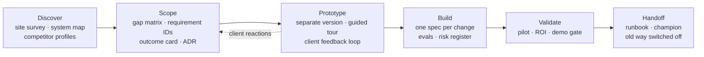

# Forward Deployed Engineering — skill and Claude Code plugin

A field kit for **Forward Deployed Engineers (FDEs)**: the engineers who embed with one client, team or programme and own a deployment from the first discovery call to the day the old way is switched off.

FDE is a process, not a checklist. The right next move depends on the project, the audience and where the work starts. So this skill **classifies the situation first**, then loads only the playbook that fits and produces an artifact the client can act on.

## Six axes

| Axis | Values |
|---|---|
| Phase | discover · scope · **prototype** · build · validate · handoff |
| Environment | cloud · regulated · on-prem · air-gapped |
| Product | ai-agent · claude-code · data-platform · api-integration · business-app |
| Engagement model | external client · internal team · programme cohort · partner |
| Starting point | greenfield · prototype-exists · legacy-replace · rescue · scale-out |
| Delivery style | classic (tickets) · spec-driven (spec → plan → build → verify) |



## What you get

| Part | Contents |
|---|---|
| Skill `forward-deployed-engineering` | Router `SKILL.md`, 18 references (one per phase, model, starting point, environment, product, research, delivery style, knowledge base, stakeholders, failure modes, STE writing), 18 artifact templates |
| Scripts (Python 3) | `fde_state.py` engagement state and gate calendar · `qualify.py` use-case scoring · `roi_calc.py` ROI that refuses to run without a baseline · `capture_screens.py` prototype screenshots and control positions · `build_tour.py` guided tour page · `ste_lint.py` plain-English linter for runbooks and agent instructions |
| Commands | `/fde:start` `/fde:discover` `/fde:research` `/fde:scope` `/fde:gaps` `/fde:requirements` `/fde:prototype` `/fde:tour` `/fde:pilot` `/fde:roi` `/fde:demo` `/fde:status` `/fde:premortem` `/fde:handoff` |
| Agents | `engagement-reviewer` (pre-mortem and health check) · `market-researcher` (sourced competitor profiles) · `demo-reviewer` (evidence-only gate review) |
| Evals | Five cases: regulated KYC discovery, Claude Code pilot ROI, air-gapped handoff, internal legacy replacement with an existing prototype, programme gate plan |

## Install

**Claude Code (plugin, recommended)**

```
/plugin marketplace add Jayzilva/FDE-forward-deployed-engineering-skill
/plugin install fde@forward-deployed-engineering
```

**Claude.ai or Claude desktop (skill only)** — download `dist/forward-deployed-engineering.skill` and upload it under Settings → Capabilities → Skills.

**Any agent that reads skills** — copy `plugins/fde/skills/forward-deployed-engineering/` into the agent's skills folder.

The scripts need Python 3.9+. `capture_screens.py` also needs Playwright (`uvx --with playwright python ...` or `pip install playwright`).

## Quick start

```
/fde:start Acme Logistics — dispatch agent pilot regulated ai-agent external greenfield
/fde:prototype ./mock/index.html
/fde:tour fde/prototype-v1
/fde:demo "Demo 1" fde/outcome-card.md specs/012/verify-report.md
```

Or just describe the situation in plain words. The skill triggers on deployment, pilot, prototype, legacy migration, gap analysis and programme-gate requests even when you do not say "FDE".

## Principles

- Find the system of record before writing code.
- Run what exists before you write requirements.
- Show, then build: a clickable prototype on consistent fictional data finds wrong requirements in days.
- Replace legacy systems domain by domain, and keep what they do well.
- Track the change, not the ticket. Done means the old way is switched off.
- Evidence over explanation: a gate item passes when an artifact exists and someone else signs it.
- Never invent client facts. Write `TBD — ask <role>`.
- The goal is to become unnecessary.

## Develop

```
python tools/package.py        # validate manifests and links, run script self-tests, build dist/*.skill
claude plugin eval plugins/fde/skills/forward-deployed-engineering --allow-tools Write,Edit,Bash
```

Contributions welcome: new environment or product sections, engagement models, templates and eval cases. Keep `SKILL.md` under 500 lines and the description under 1,024 characters.

## Credits

Builds on public FDE material (Awesome-FDE-Roadmap, GeeksforGeeks FDE roadmap, Anthropic's delivery methodology outline) and field practice from real programme and client deployments. `ste_lint.py` is vendored from [danyuchn/asd-ste100-skill](https://github.com/danyuchn/asd-ste100-skill) (MIT, see `scripts/LICENSE-asd-ste100`).

MIT licence.
